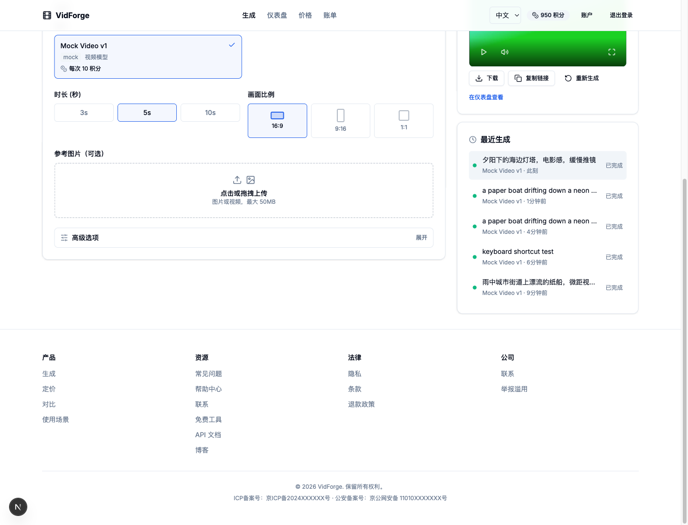
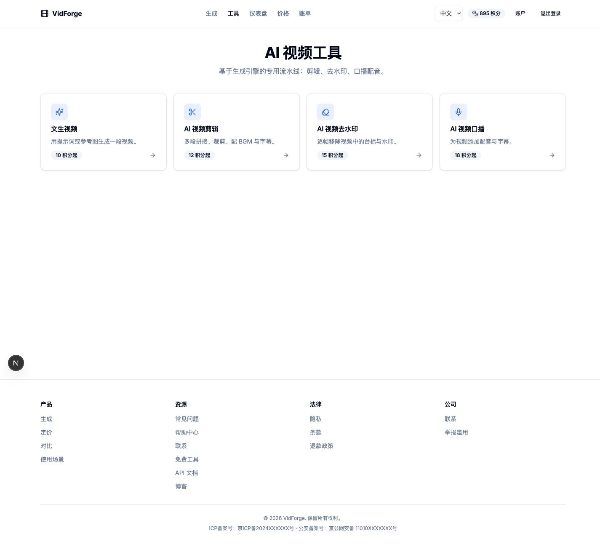

# VidForge — AI 视频生成平台

[](LICENSE)
[](https://nextjs.org/)
[](https://nestjs.com/)
[](https://fastapi.tiangolo.com/)
[](https://github.com/Mosquito1123/vidforge/actions/workflows/ci.yml)
[](CONTRIBUTING.md)

面向国内用户发布的 AI 视频 / 影片生成 SaaS：文生视频、图生视频、AI 视频剪辑、去水印、口播配音，配套积分与订阅计费、开放 API、运营后台。

> 对标 [upsampler.com](https://upsampler.com/) 的产品形态，补齐国内上线所需的合规、支付、内容安全与私有化部署能力。




---

## 目录

- [目录结构](#1-目录结构)
- [快速开始](#2-快速开始本地)
- [端口约定](#3-端口约定)
- [功能矩阵](#4-功能矩阵)
- [常用脚本](#5-常用脚本)
- [文档](#6-文档)
- [上线前检查清单](#7-上线前检查清单)
- [贡献](#贡献)
- [License](#license)


## 1. 目录结构

```
ai-video-platform/
├── apps/
│   ├── web/                 # Next.js 15 前端（App Router + next-intl 中英双语）
│   └── api/                 # NestJS 后端（REST + WebSocket + Prisma）
├── services/
│   └── worker/              # Python FastAPI + Celery 推理/后处理 Worker
├── packages/
│   ├── shared-types/        # 前后端共享 TS 类型
│   └── analytics/           # dbt 数据模型（staging / marts / metrics）
├── infra/
│   ├── docker-compose.yml       # 主栈：postgres / redis / minio / api / worker / web
│   ├── docker-compose.data.yml  # 数据中台：Kafka / ClickHouse / Metabase
│   ├── aliyun/                  # 阿里云 OSS + CDN 接入手册与 RAM 策略
│   ├── terraform/aliyun/        # OSS / CDN 基础设施即代码
│   ├── helm/                    # Kubernetes Helm Chart
│   ├── k8s/                     # 原生 K8s 清单
│   ├── nginx/                   # 域名 / SSL / 反代配置
│   ├── metabase/                # 示例看板
│   └── compliance/              # ICP 备案清单
└── docs/                    # 架构、部署、运维文档
```

## 2. 快速开始（本地）

### 2.1 依赖

| 组件 | 版本 | 说明 |
|---|---|---|
| Node.js | ≥ 20 | 前端 / 后端 |
| pnpm | 9 | Monorepo 包管理 |
| Python | ≥ 3.11 | Worker |
| PostgreSQL | 16 | 主库 |
| Redis | 7+ | 队列 / 缓存 |
| FFmpeg | 6+ | 视频后处理（Worker 需在 PATH 中） |

```bash
brew install postgresql@16 redis ffmpeg
brew services start postgresql@16
brew services start redis
```

### 2.2 数据库

```bash
createuser -s aivideo 2>/dev/null || true
psql -d postgres -c "ALTER USER aivideo WITH PASSWORD 'aivideo';" || true
createdb -O aivideo aivideo 2>/dev/null || true
```

### 2.3 安装与初始化

```bash
pnpm install
cp apps/api/.env.example apps/api/.env      # 本地开发也可直接用仓库内已生成的 .env
cp apps/web/.env.example apps/web/.env.local

pnpm --filter @app/api db:generate          # 生成 Prisma Client
pnpm --filter @app/api exec prisma migrate deploy
pnpm db:seed                                # 写入模型 / 套餐 / 积分包 / 管理员账号
```

种子账号：

| 角色 | 账号 | 密码 |
|---|---|---|
| 普通用户 | `test@example.com` | `password123` |
| 管理员 | `admin@vidforge.local` | `admin12345`（可用 `SEED_ADMIN_PASSWORD` 覆盖） |

### 2.4 启动

```bash
# 三个终端，或使用 turbo 并行：pnpm dev
pnpm --filter @app/api dev                  # http://localhost:4000  (Swagger: /docs)
pnpm --filter @app/web dev                  # http://localhost:3000

cd services/worker
python3 -m venv .venv && source .venv/bin/activate
pip install -r requirements.txt
uvicorn app.main:app --reload --port 8000   # 健康检查 /health
celery -A app.celery_app worker -l info     # 真正执行生成任务
```

### 2.5 Docker 一键启动

```bash
docker compose -f infra/docker-compose.yml up -d --build
docker compose -f infra/docker-compose.data.yml up -d   # 可选：数据中台
```

## 3. 端口约定

| 服务 | 端口 | 路径 |
|---|---|---|
| Web | 3000 | `/`、`/generate`、`/tools`、`/dashboard`、`/pricing`、`/billing`、`/admin` |
| API | 4000 | `/tasks`、`/uploads`、`/docs`（Swagger）、`/ws?userId=<id>`（WebSocket） |
| Worker | 8000 | `/health`、`/health/model`、`/files/*`（本地媒体） |
| Postgres | 5432 | |
| Redis | 6379 | |
| MinIO | 9000 / 9001 | S3 兼容对象存储 |
| ClickHouse | 8123 / 9000 | 数据分析 |
| Metabase | 3030 | BI 看板 |

## 4. 功能矩阵

### 生成能力
- 文生视频 / 图生视频，多模型路由（Mock、OpenAI 兼容、Replicate、Fal）
- 异步任务队列 + 状态机（`queued → running → post_processing → done/failed/cancelled`）
- WebSocket 实时进度推送（`task:progress`）
- 超分辨率、RIFE 插帧、Whisper 字幕、BGM + 旁白混音
- FFmpeg 后处理 → HLS 切片 + 缩略图 → 对象存储 → CDN
- 失败自动重试 / 自动退还积分；免费档水印、付费去水印

### AI 视频工具（`/tools`）
| 工具 | 流水线 | 输入 | 积分（可用环境变量覆盖） |
|---|---|---|---|
| AI 视频剪辑 | 统一规格 → 拼接（最多 6 段）→ 裁剪 → BGM 混音 → 字幕 | 视频片段、BGM、字幕文本 | 12（`TOOL_PRICE_VIDEO_EDIT`） |
| AI 视频去水印 | delogo / 区域模糊 / 马赛克（自动降级） | 源视频 + 水印区域（百分比或预设） | 15（`TOOL_PRICE_WATERMARK_REMOVAL`） |
| AI 视频口播 | TTS 配音 → 时长对齐 → 人声/BGM/原声混音 → 字幕 | 文案 + 可选背景视频 | 18（`TOOL_PRICE_VOICEOVER`） |

- 任务通过 `POST /tasks` 的 `tool` 字段选择流水线，进度、取消、重试、失败退分与文生视频一致
- TTS 适配顺序：`edge-tts`（若安装）→ macOS `say` → 静音兜底，实际使用哪个会写入任务 `output.metadata.ttsProvider`
- 字幕烧录依赖 FFmpeg 的 `libass`/`libfreetype`；缺失时自动跳过并返回 `subtitlesUrl`（SRT 可下载）


### 账号与安全
- 邮箱注册登录、JWT + refresh token、自动续期
- 手机号验证码登录 / 绑定（阿里云 / 腾讯云短信适配器）
- 邮箱验证、密码重置、TOTP 双因素、OAuth 桩（Google / GitHub）
- 实名认证（GB 11643 身份证校验、脱敏存储、重复检测）
- 登录风控（设备 / IP 扇出、滑动窗口限流、可疑登录挑战、审计日志）
- 会话管理（列出 / 吊销全部设备）

### 计费与商业化
- 订阅套餐（Starter / Pro / Studio）+ 积分包
- Stripe Checkout + Webhook（幂等、签名校验）
- 支付宝 / 微信支付适配器（下单、查单、退款、回调验签脚手架）
- 积分自动续充、失败退分、发票、退款审批
- 优惠券 / 邀请码 / 推荐关系追踪
- 人民币定价展示（前端）

### 开放平台
- 公开 REST API + API Key 管理（加密存储 + 审计）
- Webhook 订阅与签名投递
- 模型对比页 `/compare`、API 文档页 `/api-docs`

### 运营后台 `/admin`
- 概览指标、用户检索 / 封禁 / 调分
- 任务检索 / 重试 / 取消
- 模型 CRUD、退款审批、审计日志、指标图表

### 内容安全与合规
- 阿里云 / 腾讯云内容安全适配器（文本 / 图片 / 视频），OpenAI Moderation 兜底
- 审核状态展示与申诉入口
- 隐私政策、用户协议、退款政策、帮助中心、举报入口、支持工单
- ICP / 公安备案页脚占位、备案清单

### 数据中台
- Kafka（KRaft）事件流 + Schema Registry + Redpanda Console
- ClickHouse 明细 / 物化视图，dbt staging → marts → metrics + 数据测试
- Metabase 看板（用量、成本、转化漏斗）

## 5. 常用脚本

```bash
pnpm dev                 # turbo 并行启动 web + api
pnpm build               # 全量构建
pnpm test                # 单元测试
pnpm db:migrate          # Prisma migrate
pnpm db:seed             # 种子数据

cd services/worker && python3 -m pytest -q   # Worker 测试
```

## 6. 文档

- [docs/ARCHITECTURE.md](docs/ARCHITECTURE.md) — 系统架构与数据流
- [docs/DEPLOYMENT.md](docs/DEPLOYMENT.md) — 国内生产部署（阿里云 / K8s / 备案）
- [docs/OPERATIONS.md](docs/OPERATIONS.md) — 监控、告警、备份与容灾
- [docs/API.md](docs/API.md) — 对外开放 API 说明

## 7. 上线前检查清单

- [ ] 域名 ICP 备案 + 公安备案（见 `infra/compliance/icp-filing-checklist.md`）
- [ ] 生产环境变量与密钥托管（Secret Manager / KMS）
- [ ] 替换手机号短信、实名认证、内容审核、支付为正式密钥
- [ ] TLS 证书与 CDN 回源配置（`infra/nginx`、`infra/terraform/aliyun`）
- [ ] 数据库备份策略与恢复演练
- [ ] 压测与限流阈值复核
- [ ] 隐私政策 / 用户协议 / 退款政策法务复核

## 贡献

欢迎提交 Issue 与 PR，详细流程见 [CONTRIBUTING.md](CONTRIBUTING.md)，请遵守 [CODE_OF_CONDUCT.md](CODE_OF_CONDUCT.md)。
安全问题请勿公开提交，参见 [SECURITY.md](SECURITY.md)。

提交前请确保：

```bash
pnpm lint && pnpm build && pnpm test
cd services/worker && python3 -m pytest -q
```

提交信息遵循 [Conventional Commits](https://www.conventionalcommits.org/zh-hans/)：
`feat: …` / `fix: …` / `docs: …` / `refactor: …` / `chore: …`。

## License

本项目基于 [MIT License](LICENSE) 开源，Copyright (c) 2026 Mosquito1123。

变更记录见 [CHANGELOG.md](CHANGELOG.md)。
